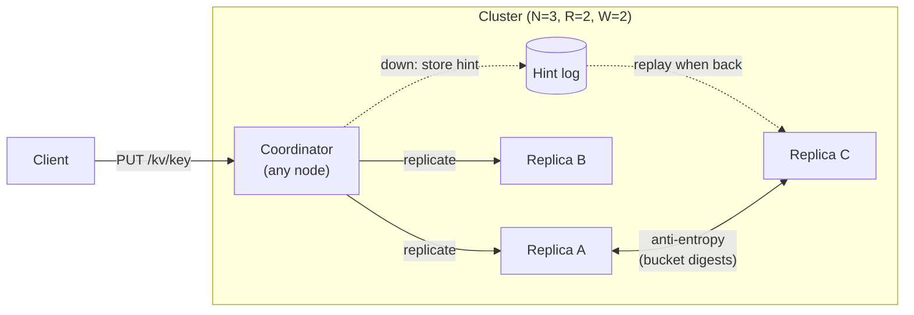
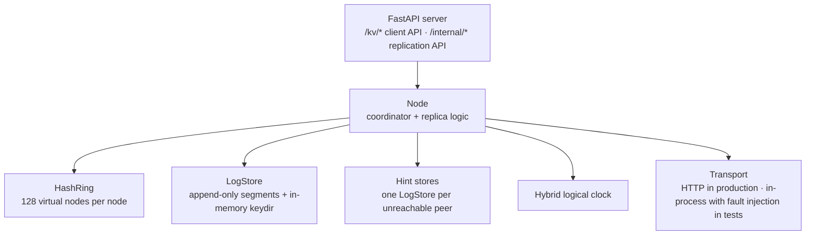

# DistributedKV

A key-value store that keeps accepting reads and writes when a machine crashes or the network splits, as long as a quorum of replicas is reachable, and that brings lagging replicas back in sync afterwards. It is a from-scratch Python implementation of the core ideas in Amazon's [Dynamo paper](https://www.allthingsdistributed.com/files/amazon-dynamo-sosp2007.pdf) (DeCandia et al., 2007) and the Bitcask storage design, built to study the failure cases rather than to replace a real database.

**Stack:** Python 3.11+ (standard library only for the engine and replication), FastAPI + httpx for the node HTTP API, Docker Compose for a 3-node cluster, pytest, GitHub Actions.

**Status:** implemented and tested. The unit and integration tests run in-process with injected failures. A CI job also runs a real 3-container cluster and stops and restarts nodes. Not deployed, and not production-ready (see *Guarantees and limits*).

## Architecture



Inside each node:



| Module | What it does |
|---|---|
| [`dkv/storage.py`](dkv/storage.py) | Bitcask-style engine. Writes append CRC32-checked records to the active segment; an in-memory index maps each key to its latest record's offset, so a read is one seek. Deletes are tombstones. Segments roll at 4 MiB; `compact()` rewrites only the latest records. |
| [`dkv/clock.py`](dkv/clock.py) | Hybrid logical clock: 48-bit milliseconds + 16-bit counter. Never goes backwards, and advances past every version it observes. |
| [`dkv/ring.py`](dkv/ring.py) | Consistent hashing (BLAKE2b, 64-bit ring) with virtual nodes. The *preference list* is the next N distinct physical nodes clockwise. |
| [`dkv/node.py`](dkv/node.py) | Leaderless replication. Any node coordinates: writes to N replicas and waits for W acks; reads from N, needs R answers, returns the newest version and repairs stale replicas. Hinted handoff and anti-entropy. |
| [`dkv/transport.py`](dkv/transport.py) | The only way nodes talk. `LocalTransport` simulates crashes and partitions in-process. |
| [`dkv/server.py`](dkv/server.py) | HTTP API and the background repair thread (hint delivery + anti-entropy with a random peer every few seconds). |

## Design decisions

**Last-writer-wins with hybrid logical clocks, not vector clocks.** Dynamo returns conflicting siblings and makes the client merge them. That is the right call for a shopping cart but pushes complexity onto every caller. Here each write gets a version `(hlc_timestamp, node_id)` that totally orders writes, and replicas keep the highest. Concurrent writes to the same key resolve deterministically: one wins and the other is lost. That is the documented trade-off.

**Re-stamping makes "later" really mean later.** Wall clocks on different machines disagree. With plain LWW, a coordinator whose clock is behind could issue a version lower than a write that has *already completed*, and the newer write would silently lose. A replica that rejects a write as stale therefore replies with the version it holds; the coordinator advances its clock past it and re-stamps. Because R + W > N, any later write reaches at least one replica that has the earlier one. The randomised test runs with node clocks up to 2 seconds apart. If replicas don't report newer versions back, that test fails.

**Strict quorums plus durable hints.** A write needs W acks from the key's real replicas. Writes to unreachable replicas are stored as *hints*. A hint store is itself a `LogStore`, so it survives a coordinator restart, and it is replayed when the replica answers again. Hints don't count toward W (Dynamo's *sloppy* quorum does count them; that improves availability but weakens the R + W > N overlap).

**No rollback on a failed write.** If only 1 of W replicas acks, the client gets `503`, but that replica keeps the write, as in Dynamo and Cassandra. A later successful write has a higher version and wins. The partition test checks exactly this.

**Crash recovery that refuses to guess.** A torn record at the tail of the newest segment is what a crash mid-write looks like: it is truncated on startup. A bad checksum anywhere else means real corruption of acknowledged data, so the node refuses to start rather than silently dropping it.

**Compaction is crash-safe.** The new segment is written to a temp file, fsynced, and atomically renamed before old segments are deleted. A crash in between leaves duplicates (the newest version wins on reload), never loss. Tombstones are kept by default, because dropping them early lets an out-of-date replica resurrect deleted keys during anti-entropy.

**Anti-entropy compares digests first.** Two nodes hash the `(key, version)` pairs they both replicate into 64 buckets (a one-level Merkle tree) and exchange records only for buckets that differ. A second pass over an in-sync pair transfers nothing.

## Bugs found by testing (and how they were proven)

These are worth reading because neither showed up in the in-process test suite at first:

1. **Writes lost under clock skew.** A coordinator whose wall clock was behind could stamp a later write with a lower version than an already-acknowledged one, so the later write silently lost. Fixed by having replicas report newer versions back so the coordinator re-stamps. The randomised test with 2 s of skew fails without the fix.
2. **Cross-node stall under concurrent writes.** The HTTP endpoint for `PUT` was `async` but made blocking calls to peers, which froze that node's event loop. Two nodes coordinating writes through each other each waited for the other's timeout. The in-process tests could not see this, because it depends on how uvicorn schedules requests. The real-container e2e test reproduced it once concurrent writers were added (CI run [40543562657](https://github.com/tanviwadgaonkar/distributedkv/actions/runs/40543562657): client timeout). Fixed by running blocking work in the thread pool. After the fix (run [40543824067](https://github.com/tanviwadgaonkar/distributedkv/actions/runs/40543824067)), 240 concurrent writes through all three nodes took 2.5 s with 0 failures and 0 spurious hints.
3. **Hints lost during delivery.** The repair thread deleted a peer's whole hint store after delivering a snapshot of it, so a hint added by a concurrent request in between was lost. Now a store is deleted only if it holds exactly what was delivered. A regression test fails on the old code.

## Guarantees and limits

What the tests show (with R + W > N, at most N − W replicas down, stable membership):
- An acknowledged write is readable from any coordinator, and a read returns the latest acknowledged write. This is checked over 300 random steps with random node failures, with and without clock skew.
- A replica that missed writes converges via hints, read repair or anti-entropy.
- Data survives process crashes and restarts; torn writes are discarded; corruption is detected. **Power loss** is only covered with `DKV_FSYNC=1` (fsync per write, about 40× slower; see Results). The default does not fsync, so an acknowledged write can be lost if the machine loses power before the OS flushes it.

What it does **not** do (yet):
- **Membership changes at runtime.** The ring is fixed at start-up from `DKV_PEERS`. Adding a node needs a restart, and keys are not streamed to a new owner except through anti-entropy.
- **A failed write is not undone.** If fewer than W replicas acknowledge, the client gets `503`, but the replicas that did apply it keep it, and hints carry it to the others later. A "failed" write can therefore become visible. This is the same trade-off as Dynamo and Cassandra.
- **Automatic compaction.** `LogStore.compact()` exists and is tested, but the server never calls it, so the log grows with every overwrite.
- **Independent deployment.** Tested as separate processes only in Docker Compose on one CI machine, not across real hosts or a lossy network.
- **Keys** are URL path segments, so they cannot contain `/`.
- **Linearizability.** Quorum reads/writes with LWW are not linearizable under concurrent writers or failures (no read-your-writes across coordinators during partitions, no compare-and-set).
- **Tombstone garbage collection** is manual (`compact(drop_tombstones_older_than=...)`).
- **Security.** No authentication or TLS on the client or internal API; run it on a private network.
- **Scale.** The keydir holds every key in memory (as in Bitcask). Anti-entropy scans the whole store each round.

## Results

From [CI run 40498503210](https://github.com/tanviwadgaonkar/distributedkv/actions/runs/40498503210) on a GitHub-hosted `ubuntu-latest` runner (`python scripts/bench.py`; 100-byte values, Python 3.12, single thread, **in-process: no network**, so the cluster rows measure engine + replication logic, not HTTP):

| Operation | Ops | Ops/s | p50 µs | p99 µs |
|---|---|---|---|---|
| LogStore put (no fsync) | 20,000 | 134,989 | 7 | 21 |
| LogStore get | 20,000 | 204,444 | 5 | 9 |
| LogStore put (fsync every write) | 2,000 | 3,226 | 281 | 653 |
| Recovery: reopen 20,000 keys | | 80 ms total | | |
| Cluster put (N=3, W=2) | 5,000 | 23,423 | 40 | 82 |
| Cluster get (N=3, R=2) | 5,000 | 24,330 | 39 | 65 |

fsync dominates write latency (about 40× slower), which is why it is configurable. A real deployment would batch fsyncs (group commit), which is on the roadmap. Shared CI runners vary between runs; treat these as orders of magnitude.

**Failure recovery, real containers** (same run, `scripts/e2e.py` against `docker compose`): with `n3` stopped, 50 writes succeeded in 1.3 s and `n1` held 50 hints for it. After `n3` restarted it had its 100 earlier keys from its own log, and caught up to all 150 within the repair interval (hints delivered, pending hints empty). With `n2` and `n3` both stopped, a write returned `503 write: 1/2 replicas answered`.

## Run it

```bash
pip install -e ".[dev]"
pytest -q                       # 37 tests: storage, ring, cluster (fault injection), HTTP; ~3 s, no network

docker compose up -d --build    # 3 nodes on :8001-8003 (set DKV_FSYNC=1 for power-loss durability)
curl -X PUT localhost:8001/kv/hello -d world
curl localhost:8003/kv/hello    # -> world, read through another node
docker compose stop n3          # writes still succeed (W=2); n1 stores hints for n3
docker compose start n3         # n3 recovers its log, then hints / anti-entropy catch it up
python scripts/e2e.py           # the scripted version of the above, run by CI
python scripts/bench.py         # engine + in-process cluster throughput
```

## Tests

| Suite | Covers |
|---|---|
| `test_storage.py` | CRUD, LWW ordering and tie-break, restart, torn tail, bad checksum at tail, corruption mid-log, segment roll + compaction, tombstone GC, interrupted compaction, HLC monotonicity |
| `test_ring.py` | determinism, load balance with/without vnodes, ~1/N movement on join, only the leaver's keys move |
| `test_cluster.py` | N-way placement, one/two replicas down, hinted handoff, read repair, delete vs. resurrection, anti-entropy (and its no-op second pass), restart with durable hints, partitions, concurrent writers converge, randomised latest-write check with and without clock skew |
| `test_server.py` | HTTP round trip and versions, dead node → hints delivered over HTTP, no quorum → 503, size limit |
| `scripts/e2e.py` (CI) | real 3-container cluster: 240 concurrent writes via all nodes, stop / restart a node, recovery from its volume, catch-up, no-quorum 503 |

## Roadmap

- [x] Log-structured storage engine with crash recovery and compaction
- [x] Consistent hashing with virtual nodes
- [x] Quorum replication, hinted handoff, read repair, anti-entropy
- [x] HTTP server, Docker Compose cluster, failure-recovery e2e in CI
- [ ] Runtime membership (join/leave with key streaming) via gossip
- [ ] Parallel fan-out to replicas (currently sequential per request)
- [ ] Group commit (batched fsync)
- [ ] Hierarchical Merkle trees and incremental digests
- [ ] Jepsen-style history checker for the randomised tests
